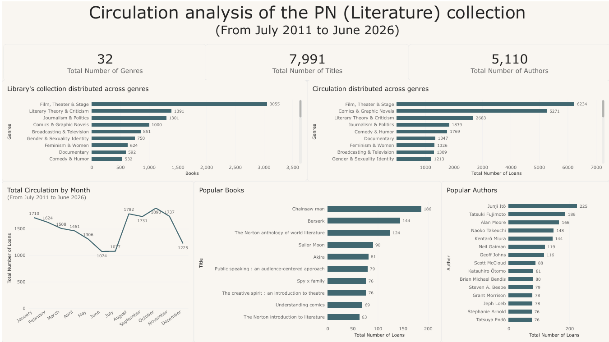
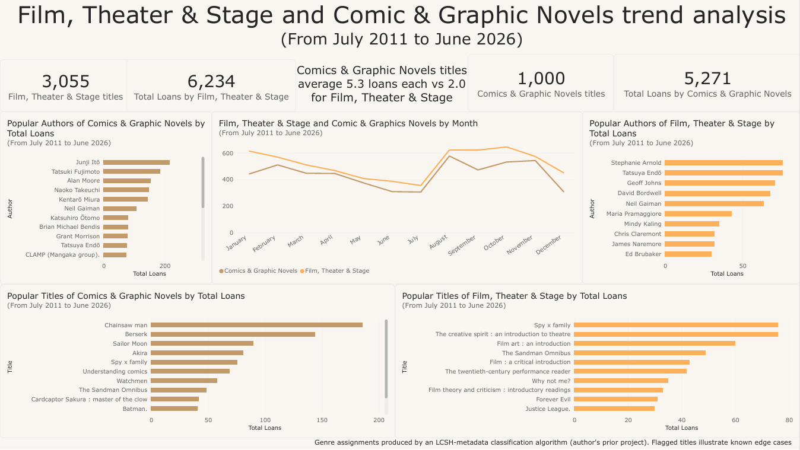

# PN Collection Circulation Analysis (Power BI)

A 2-page Power BI dashboard analyzing 15 years of circulation data (July 2011 – June 2026) for the PN (Literature) collection: **7,991 titles, 32 genres, 5,110 authors, ~18K loans.**

**Disclaimers:** the book and circulation data belongs to UTDallas McDermott Library. Genre labels were produced by an LCSH-metadata classification algorithm (author's prior project); flagged titles illustrate known edge cases of that algorithm.

## Dashboard

### Page 1 — Collection Overview

- KPI cards: total genres, titles, authors
- Collection size vs. circulation by genre (side-by-side bar charts)
- Total circulation by month — clear academic-calendar seasonality (summer dip, August spike when fall semester starts)
- Popular books and popular authors leaderboards

### Page 2 — Genre Deep-Dive: Film, Theater & Stage vs. Comics & Graphic Novels

- Headline finding: **Comics & Graphic Novels average 5.3 loans per title vs. 2.0 for Film, Theater & Stage (~2.6x efficiency)** — the smaller collection works two and a half times harder
- Monthly trend comparison: both genres follow the same seasonal rhythm
- Popular authors and titles per genre

## Key Findings

1. **Manga/graphic novels carry circulation.** Comics & Graphic Novels hold ~1,000 titles but generate 5,271 loans, vs. 3,055 Film/Theater & Stage titles generating 6,234 loans. Recommendation: rebalance acquisitions and displays toward manga and graphic novels.
2. **Circulation follows the academic calendar.** Loans bottom out in June–July and spike in August–November — front-load late-July arrivals and display refreshes.
3. **Genre metadata has documented edge cases.** Titles like *Spy x Family* and *Justice League* surface under Film, Theater & Stage, illustrating known limitations of the LCSH-based genre classifier.

## Data & Model

| Table | Rows | Notes |
|---|---|---|
| Books (titles) | 7,991 | Title, author, genre |
| Genres | 32 | Assigned by LCSH-metadata classification algorithm |
| Authors | 5,110 | |
| Circulation (loans) | ~18,000 | Jul 2011 – Jun 2026 |

### DAX measures

```
Total Number of Titles  = DISTINCTCOUNT ( Books[Title] )
Total Number of Genres  = DISTINCTCOUNT ( Books[Genre] )
Total Number of Authors = DISTINCTCOUNT ( Books[Author] )
Total Number of Loans   = COUNTROWS ( Circulation )
Loans per Title         = DIVIDE ( [Total Number of Loans], [Total Number of Titles] )
```

Card values are formatted as whole numbers via `FORMAT ( <measure>, "#,##0" )` so large values never abbreviate to "K".

## Tech Stack

| Technology | Purpose |
|---|---|
| **Power BI Desktop** | Data modeling, DAX, dashboard design |
| **DAX** | KPI measures and ratios |
| **Power Query** | Data cleaning and type normalization |
| **Python** | Prior LCSH-metadata genre classification |

## Viewing

This repository shares the dashboard design, methodology, and aggregated screenshots only — no data files are published. The underlying book and circulation data belongs to UTDallas McDermott Library.

## Screenshots

### Page 1 — Collection Overview



### Page 2 — Genre Deep-Dive



## Future Improvements

- Add a proper calendar table and year-over-year trend analysis
- Overdue-rate and active-loan tracking per branch/patron type
- Quantify classifier edge cases (flagged titles / total titles) as a data-quality KPI

## Project Context

Built as a portfolio project applying Power BI to real library operations data, following the Power BI crash course (Oct 2026). The dataset and domain come from day-to-day work at UTDallas McDermott Library.

## License

Created for educational and portfolio purposes.

## Special Thanks

Special thanks to UTDallas McDermott Library's staff for the data and domain guidance.
